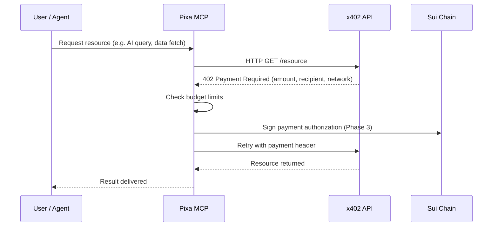
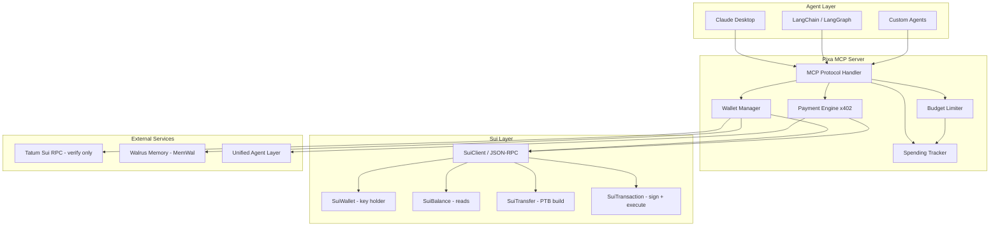

# Pixa Wallet

> An MCP-native x402 payment wallet for AI agents — Sui-only end state.


---

AI agents can reason. They can plan. They can execute.

But they cannot pay — until now.

Pixa is an MCP server that gives AI agents the ability to autonomously discover,
authorize, and settle micropayments using the x402 protocol, with budget limits
enforced independently of the model.

> **Migration status.** This repository has been migrated from its original
> Algorand implementation to **Sui**. Algorand, Stellar, and EVM/Base have been
> removed from the active runtime. Sui balance reads are live; Sui x402 payment
> signing is scheduled for Phase 3 (see Roadmap below).

---

## How It Works



---

## Architecture



---

## Installation

### Non-Technical Users — One Click

Download the `.mcpb` extension and double-click. Pixa installs automatically
into Claude Desktop. No terminal. No configuration files.

**[Download Latest Release →](https://github.com/soumyacodes007/Pixa/releases/latest)**

---

### Developers — JSON Config

Add to your Claude Desktop config file:

**macOS:** `~/Library/Application Support/Claude/claude_desktop_config.json`
**Windows:** `%APPDATA%\Claude\claude_desktop_config.json`

```json
{
  "mcpServers": {
    "pixa": {
      "command": "npx",
      "args": ["-y", "pixa-wallet-mcp"],
      "env": {
        "SUI_PRIVATE_KEY": "suiprivkey1...",
        "NETWORK": "sui-testnet",
        "MAX_PER_CALL": "0.10",
        "MAX_PER_DAY": "20.00"
      }
    }
  }
}
```

Restart Claude Desktop after saving.

---

### Custom Agents — LangChain / LangGraph

```python
from langchain_mcp import MCPToolkit

toolkit = MCPToolkit(
    server_command="npx",
    server_args=["-y", "pixa-wallet-mcp"],
    env={
        "SUI_PRIVATE_KEY": "suiprivkey1...",
        "NETWORK": "sui-testnet",
        "MAX_PER_CALL": "0.50",
        "MAX_PER_DAY": "50.00"
    }
)

tools = toolkit.get_tools()
```

---

## Environment Variables

Copy `.env.example` to `.env` for a full list. Active variables:

| Variable          | Required | Default       | Description                                           |
| ----------------- | -------- | ------------- | ----------------------------------------------------- |
| `SUI_PRIVATE_KEY` | for Sui  | —             | Sui ed25519 private key (`suiprivkey1…` or raw bytes) |
| `NETWORK`         | No       | `sui-testnet` | `sui-testnet` or `sui-mainnet`                        |
| `MAX_PER_CALL`    | No       | `0.10`        | Max USDC per single payment                           |
| `MAX_PER_DAY`     | No       | `20.00`       | Daily spending cap                                    |

With no keys set, the server runs in **READ_ONLY** mode: tools respond with an
explanatory error rather than signing anything.

---

## Tools Reference

| Tool              | Description                                               |
| ----------------- | --------------------------------------------------------- |
| `check_balance`   | View USDC and SUI balance on Sui Testnet/Mainnet          |
| `pay`             | Sign an x402 payment authorization (Sui scheme — Phase 3) |
| `x402_fetch`      | Fetch any URL with automatic 402 payment handling         |
| `spending_report` | Session and daily usage against your budget limits        |
| `search_bazaar`   | Discover x402-gated AI services                           |

---

## Development

```bash
npm ci
npm run check      # typecheck + lint + format + tests + build
```

`npm run check` is the phase gate — it must exit 0 before any change is merged.

| Script                 | Purpose                       |
| ---------------------- | ----------------------------- |
| `npm run typecheck`    | `tsc --noEmit`                |
| `npm run lint`         | ESLint over `src/`            |
| `npm run format:check` | Prettier verification         |
| `npm test`             | Vitest unit tests             |
| `npm run build`        | tsup bundle → `dist/index.js` |
| `npm run build:mcpb`   | Package the desktop extension |

---

## Security

- **Budget limits** — `MAX_PER_CALL` and `MAX_PER_DAY` are checked by
  `SpendingTracker` before any payment is signed, independently of the model's
  own reasoning.
- **Read-only default** — no keys configured means no signing path exists.
- **Secrets stay out of the repo** — `.env` is gitignored; `.env.example`
  contains placeholders only.
- **stdout discipline** — console output is redirected to stderr so the MCP
  JSON-RPC stream stays clean.
- **Single key holder** — `src/blockchain/sui/suiWallet.ts` is the only module
  that touches the Sui private key.

**Known limitations** (tracked in `docs/REVERSE_ENGINEERING_REPORT.md` §7):

- Keys are supplied via the MCP `env` block and read from plain JSON at
  `~/.x402/wallet.json` (mode 0600) — **not** an OS keychain.
- `pay` and `x402_fetch` payment paths on Sui return a clear "not yet
  implemented" error until Phase 3 — **no mock settlement is ever presented as
  real payment**.
- Spending history is in-process only, so the daily cap resets if the server
  restarts.
- There is no human-approval gate yet.

---

## Roadmap

**Current — Phase 2.5 ✅ (Sui-only end state)**

- Algorand, Stellar, EVM/Base removed from active runtime
- Sui adapter live: `src/blockchain/sui/` (client, wallet, balance, transfer, transaction)
- Baseline gate green: `npm run check` → 40/40 tests

**Next**

- **Phase 3 — Sui x402** — select scheme (`@t2000/sui-x402` vs self-implemented
  `exact` over `@x402/core` vs labelled local mock), wire into `pay` /
  `x402_fetch`
- **Phase 4 — Tatum Sui RPC** — reads and settlement verification only, never signing
- **Phase 5 — Walrus Memory (MemWal)** — persist and recall provider/spending experience
- **Phase 6 — Memory-driven commerce** — provider scoring, spending policy, approvals
- **Phase 7 — MCP server upgrade** → 17 target tools

**Future**

- Non-custodial treasury and multi-sig
- Recipient whitelisting and time-locked payments

---

## Tech Stack

- **Language:** TypeScript (strict)
- **Runtime:** Node.js 22+ (@mysten/sui requires Node 22)
- **Protocol:** Model Context Protocol (MCP), x402
- **Sui SDK:** `@mysten/sui` ^2.39.1
- **x402 core:** `@x402/core` ^2.8.0
- **Tests:** Vitest
- **Package:** `.mcpb` (MCP Bundle)

---

## Contributing

Pull requests welcome. For major changes, open an issue first.

---

## License

MIT — see [LICENSE](./LICENSE)
